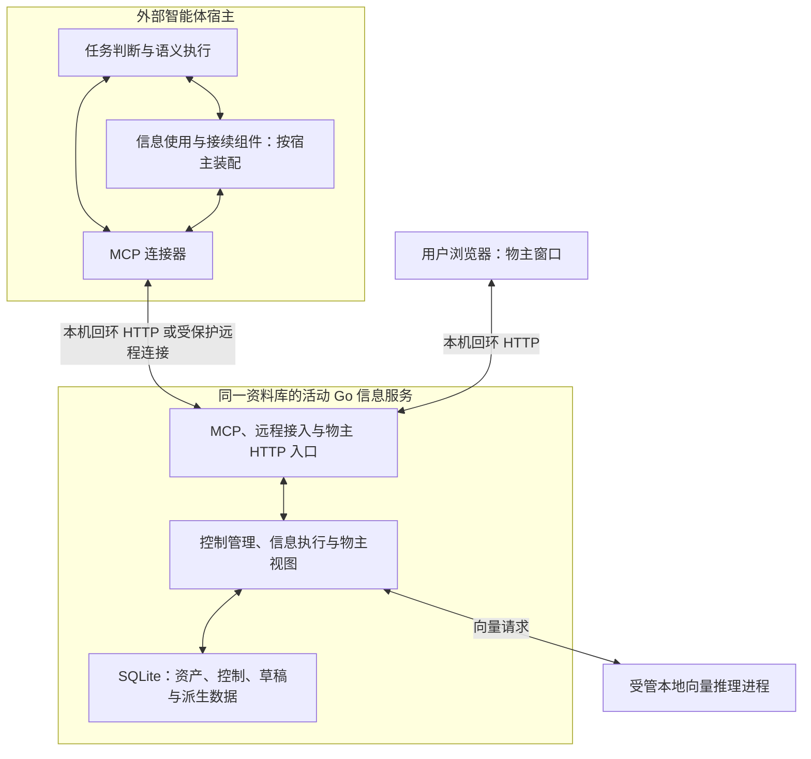

# Ownward 架构概述

本文描述当前生产实现的整体结构、职责与运行关系，是进入模块设计的总入口。结构、职责、关键运行机制或能力边界发生变化并落地后，同步更新本文。[愿景](../vision.md)与[架构演进方向](evolution-direction.md)说明长期追求和取舍，[产品需求](../product/requirements.md)说明产品应满足什么。

## 核心结构与职责

Ownward 是由用户持有、供外部智能体共同使用的个人信息体系。**日常使用围绕一个持有资料库的活动信息服务展开，智能体连接器与物主窗口共享其资产和控制状态；组织状态的维护与检索在信息服务内完成，开放语义理解与用户任务判断由外部智能体承担。**

这种分工使资料与授权独立于单个智能体会话，接入方可沿用自己的任务模型和工作方式。当前资料保存文本正文与来源，还可保存写入时显式给出的适用场景、资料关系等含义；系统推导的关联和检索表示另作派生数据维护，不替代资产。用户未发布的文稿属于私有工作状态，不进入普通资料检索。

| 组成 | 当前承担的职责 | 与其他部分的关系 |
| --- | --- | --- |
| 产品装配 | 校验构建时封定的发布组件组合（涵盖接入、存储、内核与平台向量制品）及存量库兼容身份，打开资料库并建立服务 | 日常入口使用同一装配路径，不在请求中选择一套临时内核 |
| 权威控制 | 维护体系与接入者身份、授权、管理决定、遗忘和部署交接 | 在准入、提交与结果交付边界执行有效状态约束，入口不自立权限规则 |
| 信息执行内核 | 维护资产，生成和校验语义工作，组织检索与原文交付 | 使用权威存储和当前派生状态；结构校验不等于判断开放内容真伪 |
| 持久化与派生存储 | 保存资产、控制、私有文稿和操作回执，维护词法、关系与向量数据 | 当前共存于 SQLite，通过事务、版本检查和后台维护维持一致性 |
| 本地向量能力 | 为资料和查询产生向量表示 | 由信息服务管理的独立推理进程承担，不负责语义事实判断或代答用户任务 |
| 外部智能体及宿主 | 理解内容与任务、提出语义候选、选择取证路径并形成结果 | 通过公开能力使用资料；信息使用和任务接续组件运行在宿主侧 |
| MCP 接入与物主窗口 | 分别向智能体和用户呈现已有能力 | 共享同一信息服务；窗口具有独立验证入口和私有草稿工作面，不依赖智能体在线 |

这些是逻辑职责，不是独立进程或完全隔离的 Go 包。当前内核与物主视图直接使用受内存和工作区预算约束的有界存储，产品装配将控制、执行和存储组合在同一服务中。

## 运行与部署

主程序由 Go 编译。正式装配进入有界 SQLite 存储路径，浏览器页面作为静态资源内嵌在程序中；向量模型和推理程序由配套制品提供。

下图表示日常使用中的通信与数据访问关系，不表示 Go 包的编译依赖：

本机 `ownward mcp` 是随宿主会话启停的 stdio 连接器，负责找到或启动匹配的共享服务并代理调用。持库服务独立存活，让多个会话共用同一资料内核与向量能力，避免每个智能体各自开库和加载向量模型；单个连接器退出不终止资料服务。活动服务独占资料目录的写入资格，另一版本不会直接抢占正在使用的资料。

直接开库的单次 CLI 调用，包括直连读写、备份、恢复、重建和维护，复用相同装配与目录锁。共享服务持有某资料库时，这些调用不能同时直接打开该库；MCP、物主窗口和限域草稿命令则经共享服务访问，不另建可同时写入的内核。

物主窗口通过本机所有者验证建立浏览器会话，静态页面、资料查询和管理接口复用同一服务。它没有独立业务数据库或模型进程。当前直接浏览器入口是本机入口，远程智能体接入不等于远程浏览器管理已经开放。

本地向量能力按需启动 llama.cpp 推理子进程并使用随包的 EmbeddingGemma 模型，通过本机回环接口计算表示。原生推理的内存与进程生命周期由此与 Go 资料服务分开管理，不承担用户任务判断。装配期向量包缺失、损坏或与组合声明不符会阻止服务启动；校验通过后的推理故障按具体操作处理：检索可使用非向量路径，组织可保留待处理状态，重建失败则保留原有效世代，已提交资产不因此丢失。

系统托管模式在同一信息服务实例上提供远程 TLS 入口与本机回环入口；普通本机窗口不以安装系统服务为前提。

核心、连接器、本机安装启动入口和物主窗口具有多平台实现，但系统托管远程服务的正式安装入口（`service-install`）与系统服务注册、随发布包交付的 Codex 接入包及内置后台组织执行器目前限于 Windows；非 Windows 平台尚无受支持的远程托管安装闭环。其他平台因缺少相应资源保护，不启用该后台组织执行器，保留待办供智能体主动接续；本地向量子进程仍可运行。Windows 使用 DPAPI 保护本机凭据、Job Object 约束受管子进程；其他平台使用受文件权限保护的凭据文件，向量子进程没有对应的内核级父进程退出联动。平台接口存在不等于各平台完整交付已经验证。

## 信息与状态归属

资产、控制、私有工作与派生数据在同一 SQLite 库中分开维护。同库使资产与操作回执、草稿发布与相应协作授权回收等关联变更能在本地事务中一起生效，避免跨库双写；各类状态仍按表、端口和可见性规则隔离。原文和大字段分块保存，索引持久化；流式协议、查询工作区和缓存共同受资源预算约束，不以全量原文、向量或关系常驻内存为正常运行前提。

| 状态 | 保存的内容 | 变化与恢复关系 |
| --- | --- | --- |
| 长期资产 | 正文及留存来源原件、稳定身份与版本、显式场景和关系、来源标注 | 通过条件更新维护；更换组织结果不改写原文，备份包含不可重建的信息 |
| 权威控制 | 接入授权、管理决定、删除屏障、操作回执和部署交接状态 | 与受控变更一起耐久保存；重试和恢复不能将旧决定当成新授权 |
| 物主私有工作 | 未发布草稿、草稿授权工作项与发布回执 | 与资产同库保存但隔离可见性；发布将内容和相关状态在同一事务中处理 |
| 派生数据 | 词法索引，以及语义候选、输入依赖、关系、摘要和向量表示 | 词法索引随资产事务维护；语义组织、关系与向量按世代管理，随来源变化失效、更新或重建 |
| 运行及宿主工作状态 | 有界缓存、临时解析材料、浏览器会话、宿主任务记录与近期来源引用 | 不构成第二份信息权威；宿主负责其任务接续，服务端保留必要的操作回执 |

留存来源原件用于核对来源证据，与所属已发布资料共享普通读权限、可见性和遗忘状态，有读权限的智能体可按需读取；它不代表完整编辑历史。未发布草稿仍隔离可见，不因保存到磁盘就自动成为普通资料。身份、版本和引用用于定位与核对，不能充当访问授权。

具有读取、维护和管理授权的智能体可按用户明确指令操作并发布草稿；受邀协作者经批准后，可通过 MCP 或连接同一共享服务的本机限域命令读写指定草稿，不由此取得全库权限或发布权。这两条协作通路与物主窗口共享草稿状态及授权。

凭据保护、连接位置、桌面快捷入口及用户级默认资料绑定由部署与接入适配管理：未显式指定资料目录时，本机 CLI、MCP 与物主窗口共用同一绑定并核对体系身份，避免原资料不可达时静默新建空库。它们与库中的授权决定相互配合，不以机器路径或网络地址代替信息体系身份。

## 信息内核与产品运行

### 保存与组织

新建和更新先校验操作身份、权限和目标版本，再把资产、词法索引的生效与操作回执一起提交，保存完成即具备基础词法查找能力。调用方丢失回执后可以核对同一操作，避免把已提交变更重复写入。资产成立后，再准备向量表示与语义工作；组织未完成有独立状态，不能反过来抹去保存事实。

语义工作绑定当前来源和组织上下文。外部智能体提供有来源与不确定性说明的候选，内核核验版本、证据定位、输入依赖和结构约束，再更新派生组织。来源变化或目标组织被替换时，旧候选不能直接提交；底座不把结构校验包装成对开放语义真伪的判决。

延后组织通过耐久待办与租约接续。调用方可以领取工作主动完成；已配置且平台支持后台组织执行器时，连接器也可在适当工作时机接续，目前内置 Codex App Server 适配。没有配置执行器，不代表信息服务会自行启动一个通用模型完成全部理解。表示或语义处理失败时，已保存原文仍在，待处理与不确定状态保持可见。

具体存取与组织接续机制见[存取与派生处理](../modules/storage/ingestion-and-derived-data.md)。

### 检索、阅读与来源核对

内核结合稳定身份直取、词法、向量、对象线索与有据关系取得候选；检索结果提供线索，进一步读取才交付对应原文。长文本证据定位和关系导航使用有界读取与接续，外部智能体选择下一步取证并判断何时足够，服务端不据查询自动生成最终答案。

原文交付附带可核对的来源依据，并给出指向相关更正、限定等说明的引用。再次使用时，宿主核对正文与这些关联说明是否变化、失效或不可访问，再把状态交回当前任务。来源未变化只说明所读材料仍一致，不证明语义仍适用，也不证明没有新增信息。

权限与有效性并非只在最初连接时检查。管理层维护授权决定并将有效访问状态同步到存储，流式信息主链据此在准入、提交和交付时直接校验；物主视图与管理入口在各自操作边界核验同一份控制状态。已撤销访问或失效的材料不能因旧请求继续交付。

## 信息使用与宿主协作

### 信息使用层的运行边界

信息使用层运行在外部智能体一侧，把需求、取得的原文、未决条件和结果契约交给宿主已有的智能能力。Ownward 提供材料与接续支撑，具体理解、取舍和结果组织仍由外部智能体完成。

现有可移植 Python 组件支持需求准备、初始取证与交付，也提供复用已有任务理解的快速路径和需要进一步取证的深度路径。路径选择和证据充分性由外部智能体判断；任务工作状态由宿主保存，显式沉淀后才成为长期资产。

### 外部智能体如何接入信息使用组件

当前有两种接入形态：Python 组件由宿主注入实际模型与受控工具调用；正式 Codex 接入包把规则和材料核对接入已有任务与原生事件。Codex 的快深路径注入为显式启用选项，不能把“连接了 MCP”当成全部信息使用与自动接续功能已经装配。

宿主只跟踪有界的近期来源引用，恢复或继续使用前核对变化，再把结果带入已有任务；服务不能擦除宿主历史或强行改写智能体既有结论。具体组件、启用条件和调用契约见[信息使用协作](../modules/information-use/README.md)与[信息变化架构](../modules/information-change/README.md)。

## 用户控制与恢复

普通读写与管理权限分别授予。接入者提出管理请求，可信所有者入口作出决定；后续执行与回执由共同控制状态维护，入口不因持有资料引用或普通连接而取得管理权。

遗忘先把停止使用决定耐久化，再回收受控原文、派生材料和相关恢复副本；清理失败保留停止使用状态并可接续。草稿和派生重建也受同一有效性边界约束。已交付到不受控外部系统的副本不在服务端擦除范围。

普通备份保存资产、控制、私有工作及随资产维护的词法索引，剥离按世代管理的语义组织、关系与向量表示；恢复后可直接词法查找，其余派生按待办补齐。部署交接另行保留兼容的派生状态。正常重启沿用当前权威状态；用户选择恢复旧备份则回到对应历史快照，旧连接凭据与草稿协作授权不能直接重新生效，需要所有者重新建立管理关系。普通备份仍保留原组合与内核身份，恢复后打开同样受当前发布的组合兼容性校验约束，不能作为跨平台或跨模型升级的替代路径；这与迁移当前活动体系不是同一种操作。

## 跨地点接入与迁移

远程宿主使用轻量连接器，经受保护的连接访问同一活动信息服务，不在远端复制一个独立可写内核。远程开放面与本机启动、停机、所有者恢复入口分开，认证后仍执行共同授权规则。

当前计划性迁移要求源与目的地使用同一发布组合；目标操作系统及处理器架构的向量运行制品参与组合身份，因此当前交接限于同一目标平台的同组合实例。当前服务冻结并导出交接资料，目的地校验准备，源位置耐久退役后目的地才取得活动资格。交接状态用于中断恢复和位置接续，不能把网络重连或复制文件当成新位置自动获得写权。物主浏览器入口在新位置重新建立；位置改变不重新定义资产和用户身份。

## 当前替换与研发边界

生产服务的唯一正式装配主链为 `cmd/ownward` → `assembly.Open` → `core.StreamingAssets`（信息执行内核）与 `boundedstore`（有界存储）。生产不可达的旧内存核心 `core.Service`、旧文件日志 `assetlog` 及旧派生存储索引 `derived.Store`／`derived.Index` 已清退；仓库仅在 `boundedstore` 内部保留首次打开旧目录或恢复早期 `ownward.backup/v1` 备份所需的一次性导入能力，并在 `derived`、`retrieval` 中保留无状态证据区间计算、记录值结构与查询词评分器。

当前重建在既有组合与向量空间内建立语义、关系和向量候选，校验资产与派生状态后切换世代，不切换词法索引。重建期间若相关状态发生变化，切换会被拒绝并保留原世代；当前路径没有自动追平并发变更再晋升的机制。

标准发布在构建时封存接入（含窗口和宿主组件）、装配、权威存储、内核、产品规则、语义及平台向量制品的内容身份，任一受封存内容变化都会改变组合身份；启动校验内嵌声明自洽和实际向量制品，不回读源码仓库。数据库另保存活动组合与内核身份，正常打开与普通备份恢复后打开在不兼容时都会拒绝。因此，接入或窗口修改同样可能影响存量库的打开；更新构建身份或更换向量模型后，资料库的跨组合升级还需要匹配的迁移能力，不能把直接重新编译或普通备份恢复当成升级闭环。

绑定 SQLite 之前旧目录格式的权威、派生生命周期工具及组合生命周期子命令已清退；`cmd/ownward-composition` 仅承担组合封存与校验。打包与评测工具均不在普通请求路径中；当前服务不是任意实现在线热替换的平台。跨组件设计与替换要求见[架构变更约束](../engineering/architecture-change-rules.md)，优化与验证方法见[内核持续演进体系](../engineering/kernel-evolution-system.md)及[验收体系](../delivery/acceptance-system.md)。

## 模块设计入口

| 需要深入的问题 | 现行设计入口 |
| --- | --- |
| 资产持久化、有界读写、流式内存预算、索引及恢复 | [存储入口](../modules/storage/README.md)、[存储架构](../modules/storage/architecture.md)、[有界存储实现](../modules/storage/bounded-runtime-design.md) |
| 存入、更新与延后组织的衔接 | [存取与派生处理](../modules/storage/ingestion-and-derived-data.md) |
| 语义工作、来源依赖及关系组织 | [语义理解](../modules/semantics/README.md)、[关系组织](../modules/semantics/graph-organization.md) |
| 检索、证据定位及多路候选 | [检索体系](../modules/retrieval/README.md) |
| 本地向量模型、运行时与表示空间 | [向量能力](../modules/embedding/README.md) |
| 授权、管理请求与遗忘 | [用户控制](../modules/information-control/README.md) |
| 来源变化核对与宿主接续 | [信息变化](../modules/information-change/README.md) |
| 远程接入、可信入口与部署交接 | [接入与迁移](../modules/access/README.md) |
| 宿主侧信息使用组件 | [信息使用协作](../modules/information-use/README.md) |
| 物主窗口、私有草稿与智能体协作 | [物主窗口设计](../tasks/owner-window.md)（现行详细设计仍在该任务文档中） |

第四层分册同时承载长期设计约束与历史演进记录；凡涉及**现役活动路径、表格式、运行时触发条件及跨代切换能力**，均以本文与现役生产实现为准，分册中未同步的历史旧核心／日志（已清退的 `core.Service`、`assetlog`、`derived.Store`）描述及长期目标不代表当前已落地路径。阅读时须重点区分以下已知口径差异：

- **检索与向量**：检索分册的 V1 代码与验证记录属于历史基线，不能据其待接入记录判断当前能力；向量分册中的跨向量空间原子世代切换属于长期目标设计，现役 SQLite 重建仅支持在既有组合与向量空间内切换世代。
- **存储与关系**：存储架构分册仍将词法索引一并描述为世代数据，现役词法随资产事务维护；有界存储设计仍停留在早期 SQLite 表结构，尚未涵盖现役 `schemaVersion = 6` 新增的物主草稿、来源原件与延后组织执行表（存取分册中的“格式 5”亦已落后于现役格式 6），现役表布局以[存储实现](../../internal/boundedstore/store.go)及同包[控制权威建表](../../internal/boundedstore/control_authority.go)为准；关系组织分册中将图持久化归属旧 `derived` 包的表述已由 `boundedstore` 替代。
- **用户控制与接入**：用户控制与接入分册中的“统一产品入口”及“不建设独立管理界面”等表述均滞后于现役流式与物主窗口实现；现役流式存取与遗忘直接在有界存储执行共享授权与停止使用屏障，对应入口见[流式存取](../../internal/core/streaming.go)、[流式遗忘](../../internal/core/streaming_forget.go)与[存储授权检查](../../internal/boundedstore/access.go)。
- **信息变化与延后写入**：信息变化分册中“后台组织执行器验证通过后才自动选择延后协议”的表述已过时；现役连接器由 `OWNWARD_DEFERRED_WRITE=1` 独立启用延后写入，与后台执行器是否就绪无关，见[连接器写入控制](../../cmd/ownward/connector_operation.go)。
